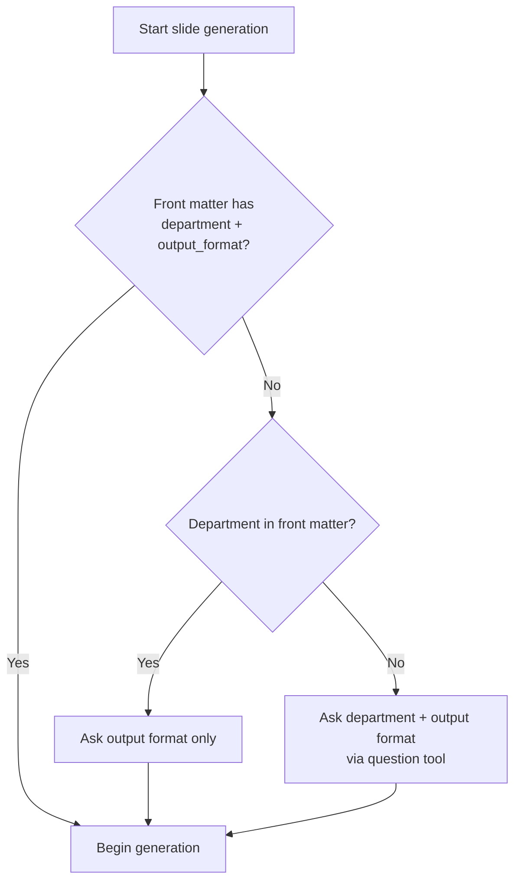

# Bosch Adaptive Slides Skill

## 0. Start here — immediate protocol

Follow this exact sequence. **Do not narrate your understanding of this skill. Do not announce routine checks.** Act or ask — then proceed.

### 0.1 Preconditions (run silently, no narration)

1. Confirm the user's Markdown input exists. If none was provided, ask for it and stop.
2. Locate a Bosch HTML template file. A real template is **mandatory** — it is the only source of logo, footer, supergraphic, colors, and typography. Search thoroughly before concluding it is missing:

   **Step 1 — Collect candidates (search in priority order):**
   - Check any path the user explicitly mentioned in their message.
   - Glob for `*.html` in `assets/` (skill-bundled template, e.g., `assets/bosch_template.html`).
   - Glob for `*.html` in the workspace root.
   - Glob for `**/*.html` in common subdirectories: `templates/`, `docs/`, `slides/`, `src/`.

   **Step 2 — Validate each candidate by content:**
   - Read each `.html` file and check whether it contains Bosch branding markers: at least `slide-footer` AND `slide-logo` (or equivalent Bosch logo SVG).
   - Discard any file that does not contain these markers — it is not a Bosch template.

   **Step 3 — Rank validated candidates and auto-select:**
   - Rank by filename priority (highest first):
     1. Contains `template` in the filename (e.g., `bosch_template.html`)
     2. Contains `bosch` in the filename
     3. Shortest filename (simplest name = most likely a hand-provided template)
   - **Auto-select the top-ranked candidate. Do NOT ask the user if at least one valid candidate exists.**
   - Only ask the user if zero valid candidates are found after content validation.

3. Verify Python 3 is available by running `python --version` once. Do not announce this check; just run it silently and proceed.

### 0.2 Missing template → ASK IMMEDIATELY. NEVER create a template.

If **zero** valid Bosch HTML templates are found after the content-validated search above, **do not generate, fabricate, invent, or create a template from memory**. Ask the user to provide the path to their real Bosch HTML template file.

**Critical asking rules:**
- Output **zero text** before the question. No preamble, no explanation, no "No template was found…" paragraph.
- The question itself must be a single short sentence, e.g., "Please provide the path to your Bosch HTML template file."
- Do not explain *why* the template is needed in the question text — the user already knows.
- Do not repeat the explanation in the question `description` field either; keep it to one line.

### 0.3 Ask the user (only if not already answered)

Before generating slides, ask the user for:

1. **Department** — Use the `question` tool to offer common Bosch departments as selectable options, plus a "Type your own" custom input option. If the Markdown front matter already contains a `department` field, skip this question.

   Common department options to offer (non-exhaustive — always include custom input):
   - `PT-GT/ETD32` — Powertrain Solutions, Embedded Technology & Digital
   - `PT/ENG1` — Engineering Division 1
   - `CC/IS` — Corporate Sector IT
   - `BGS/ES` — Bosch Global Service
   - Type your own (for any other department)

2. **Output format** — HTML, PDF, or both. Skip if front matter `output_format` is present.

Ask both questions in a single `question` tool call (two questions in one message), then begin immediately.



Pass the resolved department to the pipeline via `--department` CLI argument.

### 0.4 Anti-narration guardrails

- Do NOT say "I now have a full understanding of the pipeline" or any equivalent meta-summary of the skill or workflow.
- Do NOT announce routine system checks ("Let me check image dimensions", "Let me verify Python availability").
- Do NOT create a Bosch HTML template from scratch.
- Do NOT describe the pipeline stages you are about to run unless the user asks.
- Do NOT output explanatory text immediately before asking a question. Ask the question directly. Zero preamble.
- State only what the user needs to know, then do it.

---

## 1. Purpose

Convert Markdown supplied by the user into a polished, presentation-ready Bosch slide deck.

The skill must be **content-adaptive**. It must not rely on a predefined sequence such as cover, agenda, KPI, risk, architecture, and closing. Instead, it must infer the narrative, number of slides, section boundaries, visual forms, and layouts from the actual Markdown content.

The skill must preserve the Bosch information and brand elements embedded in the source HTML template, especially:

- Bosch logo, supergraphic, footer lines, copyright/legal wording
- Page number, main title and subtitle hierarchy
- Brand colors and typography
- Slide canvas size and content-safe area

The skill may create new content layouts when necessary, but it must not modify or obscure the protected brand zones.

---

## 2. Non-negotiable rules

1. Do not assume a fixed number of slides.
2. Do not force content into a fixed list of slide types.
3. Do not remove the source template's logo, footer, supergraphic, legal notice, or page numbering.
4. Do not place generated content inside protected brand zones.
5. Do not shrink body text below the minimum readable size merely to avoid overflow.
6. Split, merge, or restructure slides based on content density and narrative coherence.
7. Prefer one clear message per slide.
8. Prefer visual explanation over long paragraphs when the content supports a visual structure.
9. Do not invent facts, metrics, dates, owners, statuses, risks, or conclusions.
10. Clearly mark missing values as `TBD` only when a placeholder is required for deck completeness.
11. Preserve source language unless the user explicitly requests translation.
12. Always ask the user for their current department (via `question` tool with common options + custom input) and preferred output format (HTML, PDF, or Both) before beginning slide generation — unless the Markdown front matter already supplies both. Pass the resolved department via `--department` CLI argument.
13. Generate a standalone HTML deck first. Export to PDF only after the HTML deck passes validation.
14. If a generated visual is used, add a source note in speaker notes or the slide manifest.
15. Keep the original template file unchanged. Always create a new output file.
16. Never create or fabricate a Bosch HTML template. If the template is missing, stop and request it.
17. Do not narrate understanding of the skill or announce routine pre-checks. Act or ask, then proceed.

---

## 3. Expected input

### 3.1 Markdown input

The input may contain any combination of: headings, paragraphs, bullet/numbered lists, blockquotes, tables, images, links, code blocks, Mermaid diagrams, YAML front matter, explicit slide breaks, speaker notes, and raw data. The Markdown does not need to follow a strict slide syntax.

### 3.2 Optional front matter

```yaml
---
title: Platform Technical Review
subtitle: Architecture, status and next steps
author: WU Tong
department: PT-GT/ETD32
date: 2026-07-30
language: zh-CN
audience: technical-management
duration_minutes: 20
output_format: html
footer_line_1: Internal C-SC1 | PT-GT/ETD32 | 2026
---
```

Front matter has higher priority than inferred metadata, but it must not overwrite mandatory legal content unless the user explicitly provides approved legal wording.

### 3.3 Optional explicit directives

```markdown
<!-- slide-break -->
<!-- layout: two-column -->
<!-- visual: architecture -->
<!-- keep-together -->
<!-- appendix -->
<!-- notes: Explain the benchmark conditions here. -->
```

When directives conflict with safe layout or brand constraints, brand and readability rules take priority.

---

## 4. Template inspection

Before generating slides, inspect the supplied HTML template using `scripts/inspect_template.py` and extract a reusable template profile.

The profile must include at least:

- `style_block`, `script_block` — CSS and JS from the template `<head>`
- `footer_html`, `logo_html`, `supergraphic_html`, `viewer_html` — protected DOM fragments
- `available_layouts` — list of detected layout classes

### 4.1 Protected DOM fragments

Extract and reuse the source fragments for: `.slide-footer`, `.slide-logo`, `.slide-supergraphic`, `.page-number`, `.slide-topic`, `.slide-title-wrap`, `.slide-title`. Do not recreate these from memory when the original fragments are available.

### 4.2 Available source components

Detect and register existing layout classes: `two-col`, `three-col`, `panel`, `agenda`, `cover-grid`, `section-banner`, `number-grid`, `cards`, `timeline`, `matrix-wrap`, `arch`, `flow`, `chart-grid`, `image-layout`, `clean-table`, `checklist`, `roadmap`, `end-page`. This list is a component library, not a mandatory slide list.

---

## 5. Adaptive content understanding

### 5.1 Build a semantic document tree

Parse the Markdown into a semantic tree with `deck_metadata`, `sections` (each with `heading`, `level`, `intent`, `content_blocks`, `evidence`, `decisions`, `dependencies`, `speaker_notes`).

See `references/semantic_parser.md` for the full semantic parsing procedure.

### 5.2 Detect content intent

Classify each content block by meaning, not only Markdown syntax. Possible intents include: context, objective, problem statement, scope, status update, metrics, comparison, trend, timeline, roadmap, process, architecture, decision, risk, mitigation, findings, benchmark, test evidence, summary, next action, appendix. The classifier may create a new intent when the content does not fit the existing vocabulary.

### 5.3 Build the presentation narrative

Infer an appropriate narrative from the content and audience (e.g., situation→challenge→evidence→recommendation). Do not automatically add an agenda or closing slide unless it improves navigation.

See `references/narrative_planner.md` for the narrative planning procedure.

---

## 6. Slide planning

### 6.1 Generate slide candidates

Create slide candidates from semantic sections. Each candidate has: `id`, `section`, `topic`, `title`, `message` (one-sentence takeaway), `content_blocks`, `visual_intent`, `layout_candidates`, `estimated_density`, `appendix`.

### 6.2 Split rules

Split a candidate when it: contains more than one independent conclusion; combines management summary and deep technical evidence; has a table that cannot remain readable; requires more than two major visuals; exceeds target speaking time; would force body text below minimum size; requires a full-width diagram; or benefits from progressive explanation.

### 6.3 Merge rules

Merge candidates when they repeat the same conclusion, each has very low density, a metric and its interpretation should stay together, a figure and its explanation are separated without reason, or the combined content remains readable and supports one message.

### 6.4 Appendix rules

Move content to appendix when it is useful as evidence but not required for the main narrative: large raw tables, detailed formulas, long code samples, extended test logs, interface mappings, glossaries, secondary benchmarks. Appendix slides retain the same Bosch branding and numbering.

---

## 7. Layout selection

Use `references/layout_library.md` as the source of truth for:

- Layout catalog (sections 5.1–5.18) with purpose, use-when, structure, variants, and reject conditions
- Layout compatibility matrix (section 6)
- Layout scoring model (section 7) with hard rejection rules
- Image selection engine (section 7A) including asset model, orientation classification, scoring, image-text balance, and fallback
- Visual quality metrics (section 8): occupancy, density balance, visual weight, quadrant heatmap, empty region detection, alignment, panel utilization
- Section divider guard (section 9)
- Automatic repair strategy (section 10)
- Layout quality validation (section 11)

For each slide candidate, score all compatible layouts using the scoring model and choose the highest-scoring layout that passes validation.

### 7.1 Content density estimate

Estimate density from normalized character count, weighted bullet count, table cell count, chart label count, visual count, and annotation count. Density thresholds must be calibrated against the actual template safe area.

### 7.2 Layout generation

If no existing template component fits, create a new content-only layout inside `.slide-content`. New layouts must: use CSS Grid or Flexbox; reuse template color tokens; reuse border, radius, and spacing conventions; remain inside the content-safe region; avoid overlap with footer, logo, page number, and supergraphic; support print mode; avoid external runtime dependencies.

---

## 8. Visual generation policy

### 8.1 Visual priority

1. User-provided image or diagram
2. Structured HTML/CSS/SVG generated from source data
3. Mermaid rendered to SVG
4. Chart generated from explicit numeric data
5. AI-generated conceptual visual, only when it adds value and factual fidelity is not required
6. Clean typographic composition when no visual is necessary

### 8.2 Data integrity

Generate charts only from data provided by the user. Do not synthesize missing data. Preserve units, labels, ranges, and comparison baselines. Add a source field to the slide manifest. For approximate or incomplete data, display a visible qualifier.

### 8.3 Image handling

When a slide candidate contains or references an image, apply the image selection engine in `references/layout_library.md` section 7A:

1. Build the image asset registry from Markdown image syntax, directives, front matter, and discovered asset files.
2. Classify image intent: `image_dominant`, `image_text_pair`, `image_comparison`, `image_gallery`, `image_annotated`.
3. Score and select the best image using semantic relevance, aspect-ratio fit, resolution adequacy, contextual proximity, and visual diversity.
4. Determine image-text balance using the text density and image orientation rules in section 7A.4.
5. Select the image-text layout variant from the catalog (sections 5.13–5.18).
6. Record the selection in the slide manifest, including rejected alternatives and reasons.

Image rendering rules: preserve aspect ratio with `object-fit: contain`; use meaningful alt text; keep resolution sufficient for the 1365×768 canvas (min 600px shorter side); do not reuse the same hero visual on more than two slides; use the `slide-img` class; use layout-specific container classes as defined in `scripts/render_html.py`.

Never invent an image source URL. Never use a placeholder when the source does not reference one. When no suitable image is found, fall back to a structured HTML/CSS/SVG visual or a clean typographic composition.

---

## 9. Brand protection layer

### 9.1 Protected brand zones

Locked master elements: top topic/title area, bottom-left page number, bottom-center footer, bottom-right Bosch logo, bottom supergraphic strip. Generated content must only be inserted into the content-safe area.

### 9.2 Footer handling

Reuse footer HTML verbatim from the source template. Allow approved substitutions for department, classification, year, or project name. Preserve legal wording unless explicitly replaced with approved user-provided wording. Prevent footer text from colliding with the logo.

### 9.3 Cover handling

The cover may be visually distinct but must retain approved company identity. Infer cover metadata from front matter or the document. If data is missing, omit the metadata field rather than inventing it.

### 9.4 Brand drift check

Reject or repair slides that introduce: unapproved dominant colors, inconsistent title styles, logo resizing outside tolerated bounds, missing footer or supergraphic, content under the logo, mixed typography without a functional reason, or decorative effects inconsistent with the template.

---

## 10. Rendering workflow

Execute the following pipeline without asking for confirmation between stages unless the input is unusable.

- **Stage A: Inspect** — Load Markdown and template. Extract template profile and protected fragments. Detect available assets and components.
- **Stage B: Understand** — Parse Markdown into semantic blocks. Detect language, audience, intent, and narrative. Extract metadata, evidence, metrics, risks, decisions, actions, and notes.
- **Stage C: Plan** — Create adaptive slide candidates. Split or merge based on coherence and density. Determine whether cover, agenda, section divider, appendix, and closing slides are useful. Select candidate layouts using scoring. Create `slide_manifest.json`.
- **Stage D: Generate visuals** — Finish all required visuals before final HTML assembly. Generate charts and diagrams only from grounded content. Record visual sources.
- **Stage E: Render** — Clone the source template structure. Inject slide-specific topic, title, and content. Reuse protected fragments. Apply sequential page numbers. Preserve viewer and print behavior.
- **Stage F: Validate** — Render every slide to an image. Inspect for overlap, clipping, overflow, small text, and brand drift. Repair failed slides. Re-render. Perform a second consistency check.
- **Stage F.2: Layout Quality Validation** — Measure rendered occupancy, density balance, visual-weight balance, panel utilization, empty regions, and alignment quality. Apply purpose-aware thresholds. See `references/layout_library.md` section 11.
- **Stage G: Export** — Save validated standalone HTML. If requested, export to PDF. Revalidate the exported artifact. Return all requested files.

---

## 11. Validation requirements

A deck is complete only when all checks pass.

### 11.1 Structural checks

Every slide has a topic or intentional omission; every slide has a title or intentional omission; every non-cover slide has a page number; every slide has the approved footer, logo, and supergraphic unless intentionally excluded on the cover; no duplicate slide IDs; no broken internal links.

### 11.2 Visual checks

No visible overflow; no content in protected zones; no clipped text or charts; no unreadably small body text; adequate contrast; balanced margins and alignment; consistent spacing; visuals not stretched.

### 11.3 Narrative checks

Each slide has a clear message; slide order is coherent; titles describe conclusions when appropriate; repetition is minimized; evidence supports conclusions; decisions and next actions are explicit when present; appendix detail does not interrupt the main narrative.

### 11.4 Layout quality validation

Perform the layout quality validation defined in `references/layout_library.md` section 11, including: `slide_purpose_consistency`, `occupancy_ratio`, `density_balance`, `visual_weight_balance`, `quadrant_heatmap`, `empty_region_detection`, `panel_utilization`, `alignment_quality`, `decorative_element_relevance`, `title_hierarchy_consistency`. Purpose-aware exceptions are allowed for cover, section divider, statement, hero visual, and closing slides. Every exception must include a reason in the slide manifest.

### 11.5 Final consistency check

Second pass across the complete deck: footer text, logo size and position, topic and title style, color usage, page numbering, section naming, terminology, chart units and legends, date and department metadata.

---

## 12. Overflow repair strategy

Apply fixes in order defined in `references/layout_library.md` section 10:

1. Remove accidental duplication.
2. Shorten wording without changing meaning.
3. Convert prose into structured bullets or a diagram.
4. Reduce unnecessary padding or gaps within allowed limits.
5. Change to a better-fitting layout.
6. Move secondary detail to speaker notes or appendix.
7. Split the slide.
8. Reduce font size only as a last resort and never below the configured minimum.

Do not solve overflow by hiding content.

---

## 13. Recommended minimum typography

Use the source template typography whenever possible. Suggested lower bounds:

```yaml
topic_min_px: 34
title_min_px: 22
body_min_px: 17
caption_min_px: 13
footer: preserve_template
```

If content cannot fit above the minimum, split or redesign the slide.

---

## 14. Slide manifest

Create a manifest for traceability. See `schemas/slide_manifest.schema.json` for the schema. Each slide record should include: `index`, `id`, `topic`, `title`, `message`, `layout`, `layout_variant`, `source_sections`, `image` (with `selected_id`, `selected_src`, `intent`, `balance`, `image_count`, `selection_score`, `alternatives_rejected`), `visuals`, `notes`, and `validation`.

---

## 15. Output behavior

Return a concise completion message with links to generated files and a brief summary:

```text
Created an adaptive Bosch deck from the supplied Markdown.

Files:
- generated_deck.html
- generated_deck.pptx
- slide_manifest.json

Summary:
- 14 slides generated
- 3 sections inferred
- 2 dense sections split automatically
- Bosch footer, logo, supergraphic, title hierarchy and page numbering preserved
- All slides passed overflow and brand consistency checks
```

Do not claim successful validation if rendering or export validation was not completed.

---

## 16. Failure handling

- **Missing template** (HIGHEST PRIORITY): Stop immediately. Do not create, fabricate, or invent a template. Ask the user to provide the real Bosch HTML template file. The brand identity must never come from the model's memory.
- **Invalid Markdown**: Attempt tolerant parsing. If only a partial section fails, generate the remaining deck and report the excluded block.
- **Missing asset**: Use a neutral placeholder only if necessary and label it clearly. Do not invent a company logo or legal footer.
- **Export failure**: Return the validated HTML and manifest, explain that export failed, and include the exact failure stage.
- **Unsupported embedded content**: Replace with a static fallback or move to appendix while preserving the original reference.

---

## 17. Implementation reference

### 17.1 Package structure

```text
bosch-adaptive-slides/
├── SKILL.md
├── assets/
│   └── bosch_template.html      — Bosch HTML template (logo, footer, supergraphic, CSS, JS)
├── references/
│   ├── layout_library.md      — layout catalog, scoring, validation, repair
│   ├── semantic_parser.md      — semantic parsing procedure
│   └── narrative_planner.md    — narrative planning procedure
├── schemas/
│   ├── slide_manifest.schema.json
│   └── template_profile.schema.json
├── scripts/
│   ├── inspect_template.py     — extract template profile from HTML
│   ├── parse_markdown.py       — parse Markdown to slide manifest
│   ├── render_html.py          — render manifest to HTML deck
│   ├── export_pdf.py           — export HTML to PDF via Playwright
│   └── export_deck.py          — end-to-end pipeline entry point
└── tests/
    └── samples/
        ├── test_review.md
        └── test_no_dept.md
```

### 17.2 CLI usage

```bash
python scripts/export_deck.py \
  --markdown input.md \
  --template assets/bosch_template.html \
  --output generated_deck.html \
  --format html \
  --department "PT-GT/ETD32"
```

With a pre-planned manifest (LLM agent mode):

```bash
python scripts/export_deck.py \
  --manifest slide_manifest.json \
  --template assets/bosch_template.html \
  --output generated_deck.html
```

### 17.3 Adaptive planning pseudocode

```python
profile = inspect_template(template_path)
document = parse_markdown(markdown_path)
semantic_tree = understand(document)

candidates = build_slide_candidates(semantic_tree)
candidates = split_dense_candidates(candidates, profile.safe_area)
candidates = merge_sparse_candidates(candidates)

for candidate in candidates:
    layouts = get_compatible_layouts(candidate, profile.components)
    candidate.layout = select_best_layout(candidate, layouts, profile)

visuals = generate_grounded_visuals(candidates)
html = render_deck(profile, candidates, visuals)

validation = validate_rendered_deck(html, profile)
html = repair_until_pass(html, validation, max_iterations=3)

save(html)
save_manifest(candidates, validation)
```

---

## 18. Acceptance criteria

The skill is accepted when it can process at least the following Markdown patterns without requiring a fixed slide list:

1. Short management update with only three sections.
2. Long technical design document with nested headings and code.
3. KPI report containing several tables and trends.
4. Architecture document containing Mermaid and screenshots.
5. Mixed management and engineering review with appendix material.
6. Chinese, English, or bilingual Markdown.
7. Content with no explicit slide breaks.
8. Content with explicit slide directives.
9. Content with embedded images requiring image-text layouts.
10. Content with multiple images requiring image selection and grid/comparison layouts.

For every case, the generated deck must preserve Bosch branding, adapt the page count, select suitable layouts, avoid overflow, and maintain a coherent narrative.

The deck must not contain mixed-purpose section dividers, accidental empty columns, sparse oversized panels, unsupported decorative icons, or multi-region density imbalance greater than 3:1.

For image-containing slides, the deck must select the most semantically relevant image, choose the image-text layout variant based on orientation and text density, preserve aspect ratio, record selection reasoning in the manifest, and not repeat the same image on more than two slides without intent.
